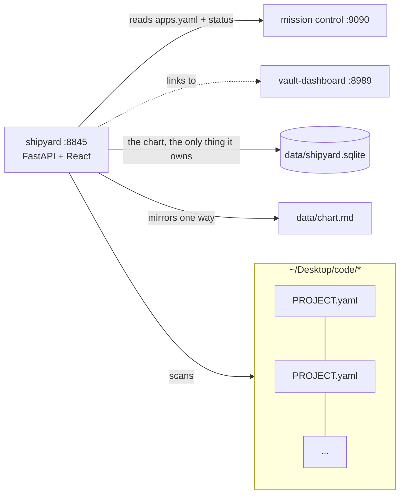

# shipyard

A local planning tool that enforces a Plan→Build→Test→Review protocol on a fleet of
repos: the API refuses to open a cycle on a problem with no observable waypoint, to
close review while a repo owes uncommitted or unpushed work, and to run a destructive
write that has not first read its impact.

**Result:** on a fresh clone, 437 backend tests pass (25 skip: browser tests without a
frontend build, and fleet-integration tests without sibling repos) plus 5 frontend
tests. 30 of them (`tests/test_gate.py`, `tests/test_direction.py`, `tests/test_tokens.py`)
cover those three refusals, starting from a planted violation that must be refused.

## Quickstart

```bash
make setup     # backend venv + frontend npm install (needs python3, node)
make test      # pytest + vitest
backend/.venv/bin/python -m uvicorn app.main:app --app-dir backend --port 8850
curl localhost:8850/health
```

The API runs standalone. The UI build (`make prod`) imports the shared `fleet-ui`
package from a sibling checkout (`../fleet-ui`), which is not public yet. It scans
`~/Desktop/code/*/PROJECT.yaml` by default (`SHIPYARD_CODE_ROOT`); Mission Control on
:9090 is optional. `scripts/demo-chart.json` is a small fictional chart for the seeder.

## What went wrong / what I learned

- Tests once overwrote the real chart export with fixtures (2026-08-06); `tests/conftest.py`
  now pins `SHIPYARD_CHART_EXPORT` to a temp dir before any app import.
- A seed run against an incomplete store silently deleted 14 nodes from the markdown
  mirror; the export now refuses to drop a title the store never held
  (`tests/test_chart_export_guard.py`).
- A guardrail test ("edge count unchanged") passed while the feature dropped four
  projects off the board (`docs/cycles/PLAN — board groups.md`); the first real
  run of the protocol's own arc routed around its own gate at the shell (`Backlog.md`).
- This repo's work was once committed and tagged in a sibling repo after a stray
  `cd`; caught before push (`docs/cycles/v0.5.0 — Dashboard, checklists retired.md`).

The cycle records are in `docs/cycles/`, the decisions in `docs/adr/`.

## The seam it exposes

1. **`PROJECT.yaml`** — a small manifest at each repo root (identity, stage, links).
   The manifest travels with the code; shipyard is only the aggregator.
2. **REST API** — `GET /api/projects`, `GET /api/projects/{id}`, `GET /api/yard`,
   `GET /api/goals`, `POST /api/problems`, `POST /api/problems/{id}/cycles/open`.
3. **Two gates, both refusing at the API and neither advisory.** `_open_gate` refuses
   to *open* a cycle on a problem with no waypoint or in a repo already running one;
   `_review_gate` refuses to tick `review` while a repo owes uncommitted or unpushed
   work. See `docs/adr/0005-what-an-open-cycle-is.md`.

The **chart** is the only thing shipyard owns — problems, each with an observable,
in `data/*.sqlite` and mirrored one-way to `data/chart.md` (`SHIPYARD_CHART_EXPORT`). Everything else is read
from where it already lives: git, `PROJECT.yaml`, Mission Control, the Learn Hub.

There was a third seam, `standards.yaml` — versioned checklist templates over
spike/tool/product stages. It was deleted in v0.5.0 for scoring repos against a
checklist when conformance was never the point, and `stage` followed it in v0.29.3.
A rewritten standard is planned and will not reuse either.

## Architecture



## Branches

`main` is prod — what Mission Control runs, always startable. `dev` is the
workbench — day-to-day commits. Promote with `git checkout main && git merge dev`,
run `make test`, restart in MC. See `docs/adr/0002-branching-model.md`.

## Health & ports

- Port: **8845** (`SHIPYARD_PORT`)
- `GET /health` → `{ok, checks:{db, code_root, mc}, freshness}` (fleet convention)
- Config via env with sane defaults: `SHIPYARD_PORT`, `SHIPYARD_CODE_ROOT`,
  `SHIPYARD_MC_URL`, `SHIPYARD_DB`

The only outbound read is Mission Control, and it is read-only and degrades to a
blank surface when MC is down. The Habits tab is a **link** to vault-dashboard,
not a read of it: vault-dashboard owns the daily notes, so it owns the habit
record and how it looks. The link is built from the browser's current hostname,
so it works over the tailnet as well as locally.
