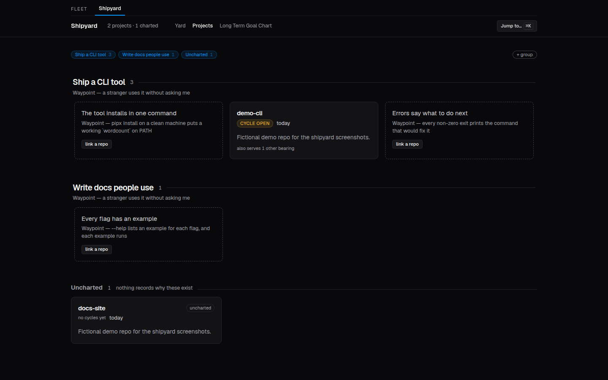
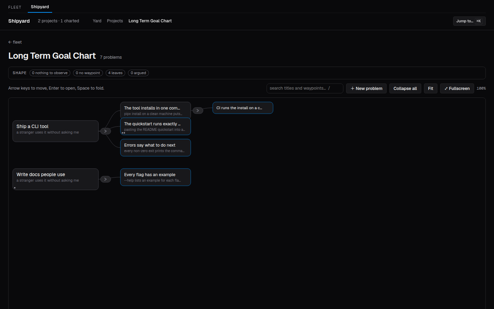
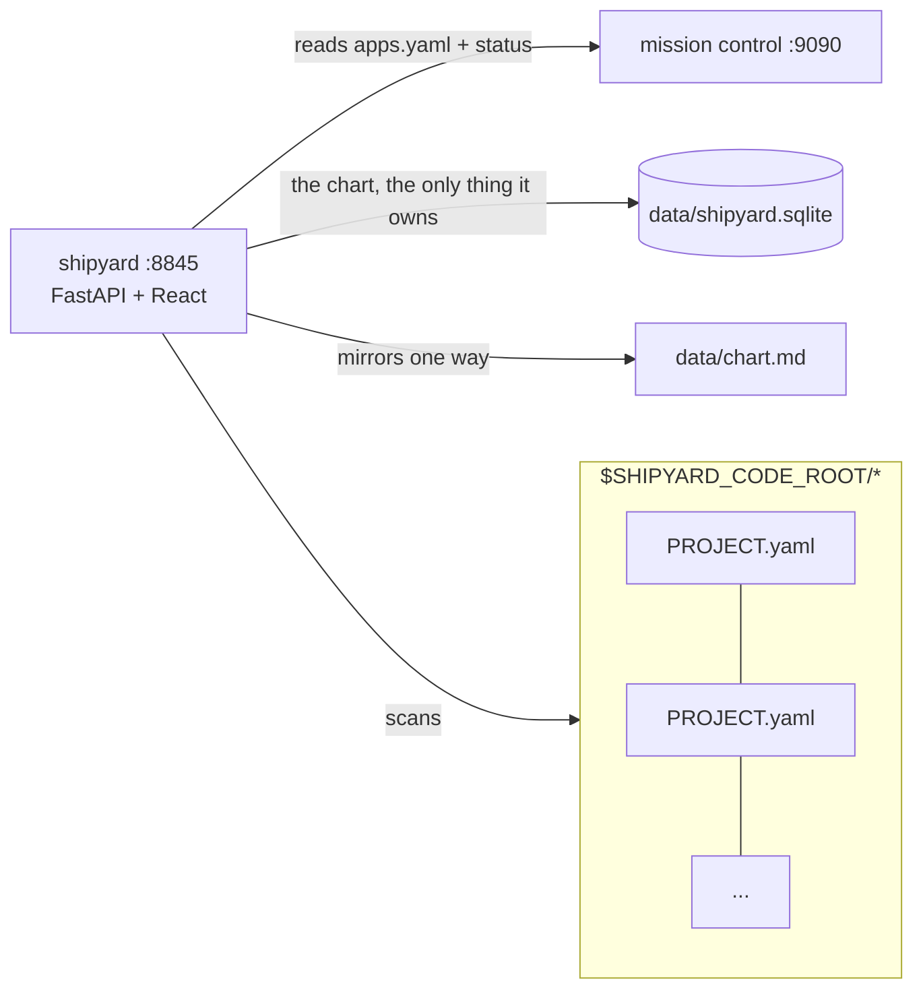

# shipyard

**What it is:** a planning service for software work that refuses unsafe actions at
the API layer, not just in the UI. It won't start work that has no measurable goal,
won't let you mark work reviewed while code is uncommitted or unpushed, and won't run
a destructive delete until the caller has first read what it would break.

**Why it matters:** guardrails that live only in a UI (or in a prompt) are suggestions;
any script, agent or `curl` can walk around them. Here every client, human or AI agent,
hits the same refusal with a sentence that names the missing fact.



### Words used below

- **Problem**: one unit of intended work, stored in shipyard's database.
- **Waypoint**: a problem's *observable* success criterion ("pasting the quickstart into
  a fresh shell produces the documented output"). No waypoint, no work.
- **Chart**: the tree of problems, from top-level goals down to the repo-sized ones.
  It is the only data shipyard owns.
- **Cycle**: one Plan→Build→Test→Review pass on a problem, closed by cutting a git tag.
- **Fleet**: the set of local git repos shipyard scans (each has a `PROJECT.yaml`).

**Result:** on a fresh clone, 437 backend tests pass (25 skip: browser tests without a
frontend build, and fleet-integration tests without sibling repos) plus 5 frontend
tests. 30 of them (`tests/test_gate.py`, `tests/test_direction.py`, `tests/test_tokens.py`)
cover those three refusals, starting from a planted violation that must be refused.

## Quickstart

```bash
make setup                 # backend venv + frontend npm install (needs python3, node)
make test                  # pytest + vitest
make prod PORT=8850        # build the UI and serve API + UI on http://127.0.0.1:8850
```

It scans `$SHIPYARD_CODE_ROOT/*/PROJECT.yaml` (default `~/code`); every path is an
env var (see `.env.example`). The shared header styles and fonts are vendored in
`frontend/src/vendor/fleet-ui/`, so a fresh clone builds. Mission Control (a separate
process supervisor) is optional; without it the runtime-status surface is blank.

To try it with fictional data: create the two top-level problems the seed names
(`Ship a CLI tool`, `Write docs people use`) with `POST /api/problems`, then
`make chart-seed`. The screenshots in `docs/screenshots/` were taken that way, against
two throwaway git repos, with Playwright.

### A refusal, verbatim

Opening a second cycle in a repo that already has one open (real output from the
demo setup above):

```text
$ curl -X POST localhost:8871/api/problems/591005a781a2/cycles/open \
    -H 'content-type: application/json' \
    -d '{"version":"v0.1.0","title":"Quickstart runs as written","repo":"demo-cli"}' \
    -w '  [HTTP %{http_code}]'
{"detail":"open refused: demo-cli already has a cycle open (v0.1.0). A record with no
tag is open — close it by cutting its version, or abort it to the backlog and delete
the record"}  [HTTP 422]
```

(The first identical call returned 200 and opened the cycle; JSON wrapped for width.)

## What went wrong / what I learned

- Tests once overwrote the real chart export with fixtures (2026-08-06); `tests/conftest.py`
  now pins `SHIPYARD_CHART_EXPORT` to a temp dir before any app import.
- A seed run against an incomplete store silently deleted 14 nodes from the markdown
  mirror; the export now refuses to drop a title the store never held
  (`tests/test_chart_export_guard.py`).
- A guardrail test ("edge count unchanged") passed while the feature dropped four
  projects off the board (`docs/cycles/PLAN — board groups.md`); the first real
  run of the protocol's own arc routed around its own gate at the shell (`Backlog.md`).
- This repo's work was once committed and tagged in a sibling repo after a stray
  `cd`; caught before push (`docs/cycles/v0.5.0 — Dashboard, checklists retired.md`).

The cycle records are in `docs/cycles/`, the decisions in `docs/adr/`.

## The seam it exposes

1. **`PROJECT.yaml`** — a small manifest at each repo root (identity, stage, links).
   The manifest travels with the code; shipyard is only the aggregator.
2. **REST API** — `GET /api/projects`, `GET /api/projects/{id}`, `GET /api/yard`,
   `GET /api/goals`, `POST /api/problems`, `POST /api/problems/{id}/cycles/open`.
3. **Two gates, both refusing at the API and neither advisory.** `_open_gate` refuses
   to *open* a cycle on a problem with no waypoint or in a repo already running one;
   `_review_gate` refuses to tick `review` while a repo owes uncommitted or unpushed
   work. See `docs/adr/0005-what-an-open-cycle-is.md`.

The **chart** is the only thing shipyard owns — problems, each with an observable,
in `data/*.sqlite` and mirrored one-way to `data/chart.md` (`SHIPYARD_CHART_EXPORT`).
Everything else is read from where it already lives: git, `PROJECT.yaml`, Mission Control.



There was a third seam, `standards.yaml` — versioned checklist templates over
spike/tool/product stages. It was deleted in v0.5.0 for scoring repos against a
checklist when conformance was never the point, and `stage` followed it in v0.29.3.
A rewritten standard is planned and will not reuse either.

## Architecture



## Branches

`main` is always startable; `dev` is the workbench. Promote with
`git checkout main && git merge dev` after `make test`. See
`docs/adr/0002-branching-model.md`. Contributor notes: `CONTRIBUTING.md`.

## Health & ports

- Port: **8845** by default (`make prod PORT=...`); binds 127.0.0.1, because the API
  has no auth and can write.
- `GET /health` → `{ok, checks:{db, code_root, mc}, freshness}`
- Config via env with neutral defaults: `SHIPYARD_CODE_ROOT`, `SHIPYARD_DB`,
  `SHIPYARD_MC_URL`, `SHIPYARD_CYCLES_ROOT`, `SHIPYARD_CHART_EXPORT` (`.env.example`).

The only outbound read is Mission Control; it is read-only and degrades to a blank
surface when MC is down.
