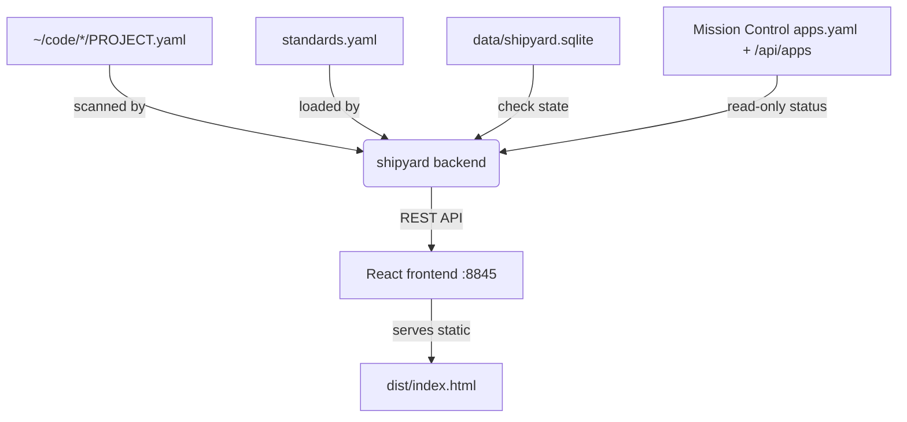
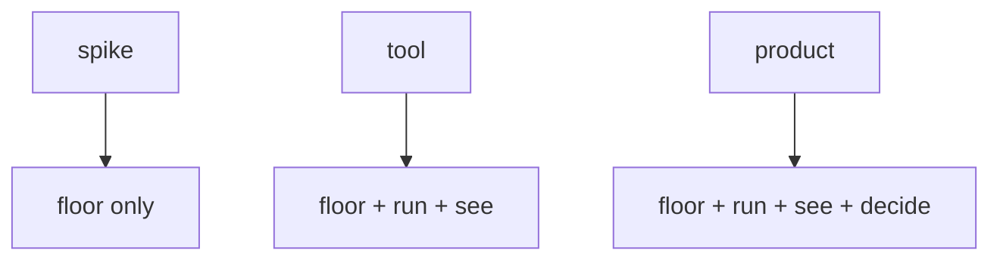
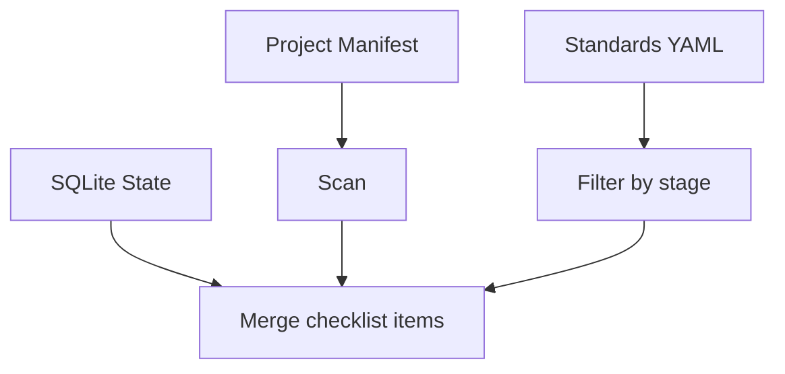
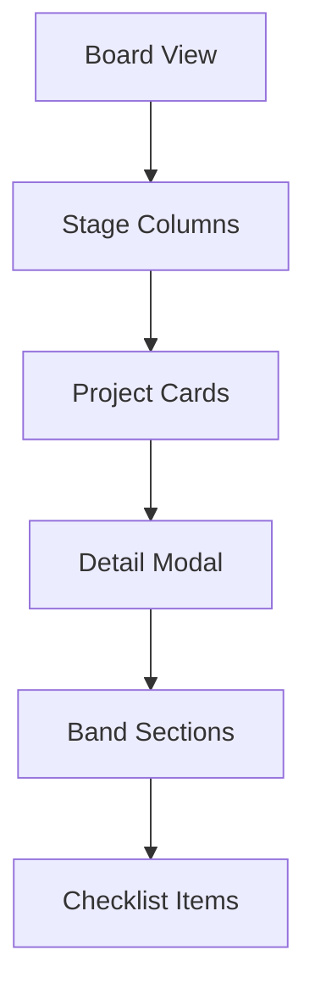
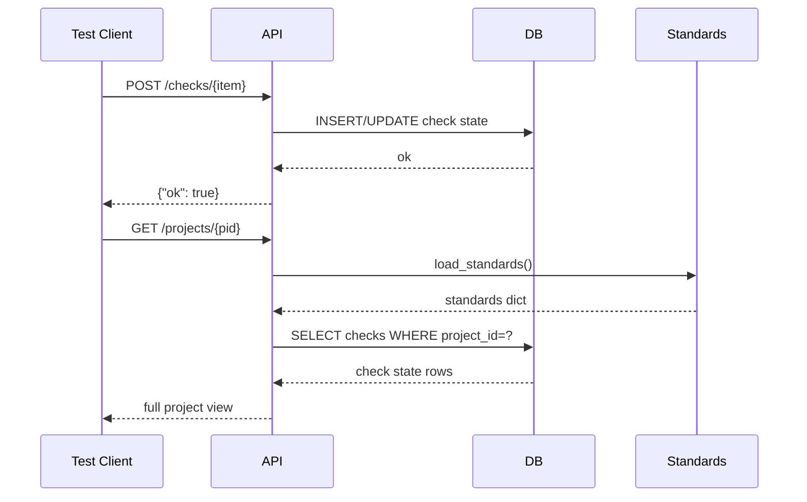

# Shipyard Wiki

> A local project lifecycle manager for the ~/code/ fleet that tracks repository stages, checklists, and integration status with Mission Control.

> Generated 2026-07-09 by DeepWiki-Open (local, keyless: qwen3-coder-next + nomic-embed-text via Ollama).
> Machine-owned doc floor — regenerate rather than hand-edit; decisions live in docs/adr/.

<details>
<summary>Relevant source files</summary>

The following files were used as context for generating this wiki page:

- standards.yaml
- PROJECT.yaml
- backend/app/main.py
- README.md
- tests/test_smoke.py
- frontend/src/App.jsx
- frontend/index.html
- frontend/src/styles.css
- frontend/src/main.jsx

</details>

# Shipyard Project Lifecycle Manager

Shipyard is a local, keyless project-lifecycle manager for the `~/code/` fleet. It aggregates project manifests (`PROJECT.yaml`) and enforces versioned checklists defined in `standards.yaml`, bridging with Mission Control for live runtime status while storing checklist state locally in SQLite.

## Overview

Shipyard answers *"where is it in its life?"* for each codebase in the fleet: what stage (spike/tool/product), which standard items are done, what's owed next, and where every artifact lives. It operates entirely locally without external dependencies beyond Mission Control for optional live status integration.

The system consists of:
- A FastAPI backend (`backend/app/main.py`) that scans manifests, loads standards, manages checklist state in SQLite, and bridges read-only to Mission Control
- A React frontend (`frontend/src/App.jsx`) providing a visual board view organized by stages and bands
- Versioned checklist templates (`standards.yaml`) with items grouped into bands (floor/run/see/decide) and applicable to project stages

Projects declare their lifecycle state via `PROJECT.yaml` manifests, which travel with the code. Shipyard aggregates these manifests and overlays checklist progress without modifying them.

## Architecture



The backend scans `CODE_ROOT` (default: `~/code`) up to depth 4, skipping known directories like `.git`, `node_modules`, etc. For each directory containing a `PROJECT.yaml`, it loads the manifest and merges it with checklist items from `standards.yaml` filtered by the project's stage.

Checklist state (done/not, notes, timestamps) is stored in SQLite under `data/shipyard.sqlite`. Mission Control integration is read-only: shipyard reads `apps.yaml` for registry info and calls `/api/apps` for live status, degrading gracefully if MC is unavailable.

## Standards Model

The checklist standard defines items grouped by bands (floor/run/see/decide) and applicable project stages (spike/tool/product). Each item has an ID, label, hint, band, and stage list.

### Band Definitions

| Band | Purpose | Applicable Stages |
|------|---------|-------------------|
| floor | Owed by every project including spikes | spike, tool, product |
| run | Standard verbs + config discipline | tool, product |
| see | Observability as primary safety layer | tool, product |
| decide | Continuous design documentation | product |



### Example Standard Items

| ID | Band | Stage | Label |
|----|------|-------|-------|
| git-init | floor | spike/tool/product | Git repository initialized |
| make-dev | run | tool/product | `make dev` starts the dev loop |
| health-endpoint | see | tool/product | `/health` returns `{ok, checks, freshness}` |
| adr | decide | product | docs/adr/ holds dated decision records |

Items are versioned via the standard's `version` field. Evolving the standard (editing `standards.yaml`) causes all projects to show fresh unmet items without breaking existing check state.

## API Endpoints

### `/health`
Returns health status following fleet convention:
```json
{
  "ok": true,
  "checks": {
    "db": true,
    "code_root": true,
    "standards": true,
    "mc": false
  },
  "freshness": "2024-01-01T00:00:00"
}
```

### `/api/standards`
Returns the loaded `standards.yaml` content including version, stages, and items.

### `/api/projects`
Lists all projects with checklist progress:
```json
{
  "projects": [
    {
      "id": "shipyard",
      "name": "Shipyard",
      "stage": "tool",
      "checklist": [...],
      "mc_info": [],
      "progress": {"done": 12, "total": 20}
    }
  ],
  "standards_version": 1
}
```

### `/api/projects/{pid}`
Returns detailed view for a single project including full checklist and Mission Control info.

### `POST /api/projects/{pid}/checks/{item_id}`
Updates checklist item state:
```json
{
  "done": true,
  "note": "verified"
}
```
Response: `{"ok": true}`

## Checklist State Management

Checklist state is stored in SQLite with schema:

| Column | Type | Description |
|--------|------|-------------|
| project_id | TEXT NOT NULL | Project ID from PROJECT.yaml |
| item_id | TEXT NOT NULL | Standard item ID (e.g., "git-init") |
| done | INTEGER NOT NULL | 1 for true, 0 for false |
| note | TEXT | Optional human-readable note |
| updated_at | TEXT NOT NULL | ISO timestamp |



The `project_view` function in `backend/app/main.py:130-152` retrieves check state, filters standard items by project stage, and merges with Mission Control status.

## Frontend UI

The React frontend (`frontend/src/App.jsx`) displays projects organized by stages (spike/tool/product) in a board layout. Each project card shows:
- Name, description, stage
- Progress bar (done/total checklist items)
- Tags and links to app/docs/github

Clicking a project opens a detail view with:
- Checklist items grouped by band
- Toggle checkboxes for each item
- Mission Control status dots
- Project links and path



## Configuration

All configuration uses environment variables with sensible defaults:

| Variable | Default | Description |
|----------|---------|-------------|
| `SHIPYARD_PORT` | 8845 | Backend port |
| `SHIPYARD_CODE_ROOT` | ~/code | Directory to scan for manifests |
| `SHIPYARD_MC_URL` | http://localhost:9090 | Mission Control API URL |
| `SHIPYARD_DB` | data/shipyard.sqlite | SQLite database path |

## Development Workflow

```bash
make setup   # backend venv + frontend npm install
make prod    # build frontend, serve app on :8845
make dev     # backend reload + vite dev server :5178
make test    # smoke tests
```

The `make dev` target runs the FastAPI backend with auto-reload and Vite's development server for hot module replacement in the frontend.

## Testing

Smoke tests (`tests/test_smoke.py`) verify:
- `/health` returns expected structure
- `/api/standards` loads version 1+ with required stages
- Project scan includes shipyard itself
- Checklist item state round-trips correctly (POST + GET)
- Unknown items return 404



## Source Citations

All functionality is derived from the provided source files. Key implementation details:
- Manifest scanning logic: `backend/app/main.py:42-63`
- Checklist assembly: `backend/app/main.py:157-170`
- SQLite schema and operations: `backend/app/main.py:31-38`
- Mission Control integration: `backend/app/main.py:79-108`
- Frontend component structure: `frontend/src/App.jsx`